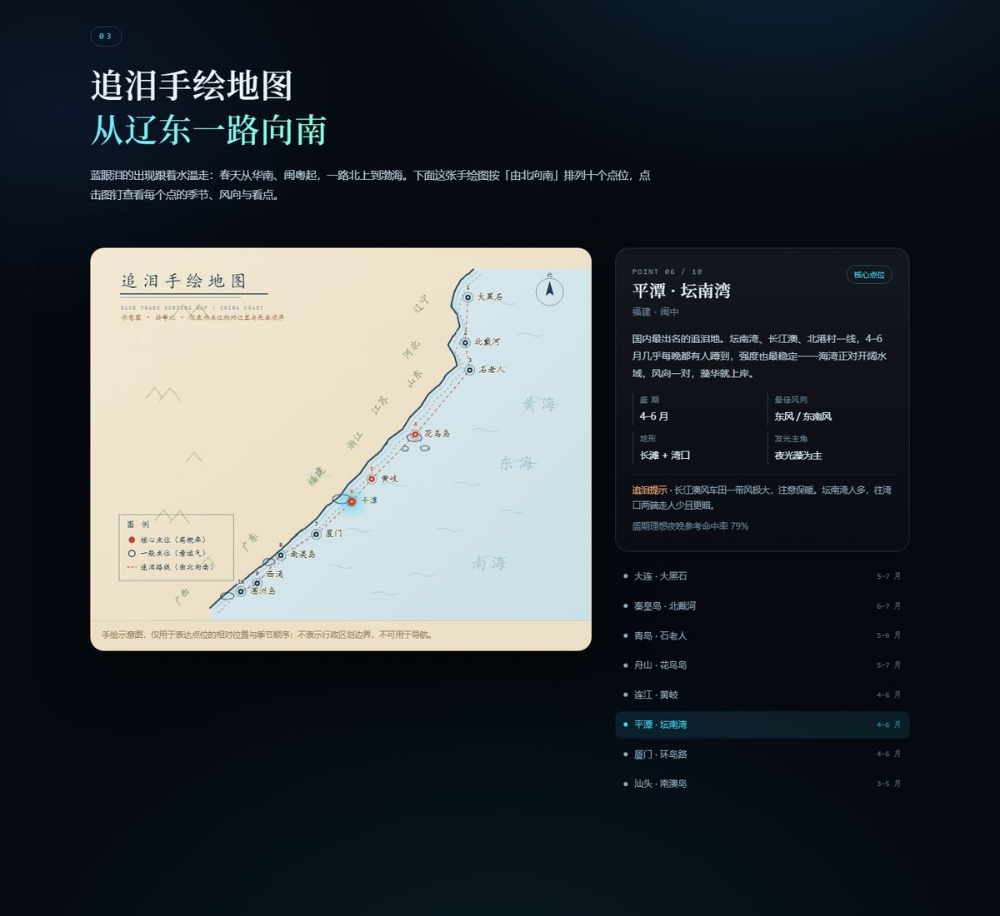
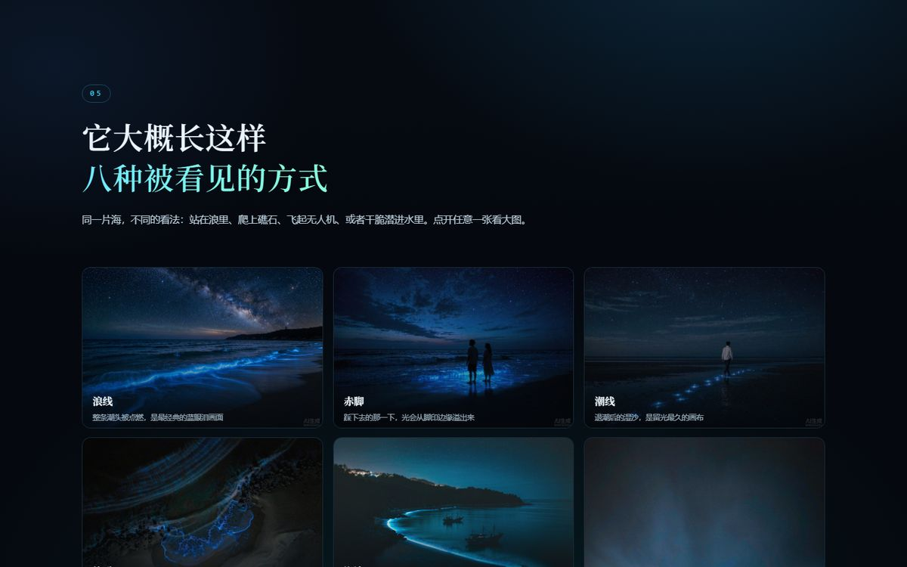

<div align="center">

# 蓝眼泪 · 追泪指南

**把「今晚到底能不能看到蓝眼泪」拆成一套可以自己调参数的算法。**

一个讲清荧光海**发光原理**、**生成条件**、**点位分布**与**出现概率**的静态知识站。

[](https://github.com/MiChuan/BlueTears/actions/workflows/pages.yml)
[](https://michuan.github.io/BlueTears/)
[](./LICENSE)


[](https://michuan.github.io/BlueTears/)

<sub>点击图片进入线上站点</sub>

</div>

---

## 目录

- [这是什么](#这是什么)
- [功能特性](#功能特性)
- [界面一览](#界面一览)
- [快速开始](#快速开始)
- [目录结构](#目录结构)
- [部署](#部署)
- [自定义](#自定义)
- [概率模型说明](#概率模型说明)
- [数据与免责声明](#数据与免责声明)
- [贡献](#贡献)
- [许可证](#许可证)

## 这是什么

「蓝眼泪」不是一种生物，而是一群微小生物被扰动后发出的冷光 —— 主要是**夜光藻**（*Noctiluca scintillans*）和**海萤**（*Vargula hilgendorfii*）。它每年春天随水温回升从南海一路北上报到，能不能看到，取决于水温、风向、潮汐、月光十来个条件的叠加。

这个站点做三件事：

1. **讲清楚** —— 发光为什么是蓝的、哪些条件缺一不可；
2. **画出来** —— 从辽东到北部湾的 10 个点位，由北向南排列；
3. **算一算** —— 选好时间、天气、月相，给一个命中率，并把每一项条件的贡献拆开给你看。

整个站点是**三个文件加几张图**：纯 HTML / CSS / 原生 JS，**零依赖、零构建、零后端、零追踪、零 Cookie**。没有 `npm install`，没有框架运行时，没有任何统计脚本。

## 功能特性

| 板块 | 内容 | 实现要点 |
| :--- | :--- | :--- |
| **01&nbsp;原理** | 荧光素–荧光素酶反应链、为什么是 474 nm 蓝光（海水衰减最小 + 人眼暗视觉峰值）、夜光藻与海萤的形态与触发方式对比 | 一块可以用光标划过「点亮」的 `<canvas>` 海面，用粒子模拟受扰发光 |
| **02&nbsp;条件** | 水温、盐度、营养盐、风向、潮汐、月光、季节、地形共 8 张条件卡，附「黄金窗口」公式与赤潮风险提示 | 纯 CSS grid，卡片按重要度分级 |
| **03&nbsp;地图** | 10 个点位的手绘风追泪地图，从辽宁大黑石到广西涠洲岛，点击可查看季节、最佳风向、地形与提示 | 纯 SVG，`feTurbulence` 抖动 + 手绘点状滩涂，无地图 SDK、无外部瓦片 |
| **04&nbsp;概率** | 8 因子加权模型 + 交互计算器（点位 / 月份 / 水温 / 风向 / 风力 / 潮汐 / 月相 / 天况 / 白天迹象），输出命中率、因子分解条、针对性建议与横向排名 | 全部在前端算，无网络请求 |
| **05&nbsp;图集** | 8 张蓝眼泪实景卡片，瀑布流排布，支持灯箱查看 | 灯箱支持 `←` `→` 切换、`Esc` 关闭、移动端左右滑动 |

其它细节：深色海洋主题与移动端适配；`prefers-reduced-motion` 下自动关闭动画；无外部字体与 CDN，断网也能完整浏览。

## 界面一览

| 原理 | 条件 |
| :---: | :---: |
|  |  |
| **追泪地图** | **今夜概率** |
|  |  |



## 快速开始

不需要装任何东西。仓库就是成品，`index.html` 打开即用。

```bash
git clone https://github.com/MiChuan/BlueTears.git
cd BlueTears
```

任选一种方式预览：

```bash
# 方式一：Python（系统自带）
python -m http.server 8000

# 方式二：Node
npx serve .

# 方式三：直接双击 index.html
```

然后访问 <http://localhost:8000>。

> 直接双击 `index.html` 也能看，但 `file://` 协议下部分浏览器的 canvas 与滚动行为可能受限，建议起一个本地服务器。

## 目录结构

```
.
├── index.html                  # 单页结构（含手绘 SVG 地图的主体）
├── assets/
│   ├── css/
│   │   └── style.css           # 全部样式，深色海洋主题 + 响应式
│   ├── js/
│   │   └── main.js             # 点位数据 + 概率模型 + canvas + 地图交互 + 灯箱
│   ├── img/                    # 图集图片（AI 生成，可替换）
│   └── favicon.svg
├── docs/                       # README 预览图（页面不引用）
├── .github/workflows/pages.yml # GitHub Pages 自动部署
├── .nojekyll                   # 让 GitHub Pages 跳过 Jekyll 处理
├── LICENSE
└── README.md
```

所有资源均使用**相对路径**（`./assets/...`），因此放在仓库根目录、子目录，或任意 CDN 子路径下都能正常加载。

## 部署

### GitHub Pages（仓库已配置）

本仓库使用 **GitHub Actions** 部署，工作流见 [`.github/workflows/pages.yml`](./.github/workflows/pages.yml)。流程是：`configure-pages` → 把仓库根目录打包成 artifact → `deploy-pages`。

**你不需要做任何设置** —— 推送到 `main` 即自动发布：

```bash
git add .
git commit -m "update"
git push
```

约 30 秒后访问 <https://michuan.github.io/BlueTears/>。想手动重跑：**Actions → Deploy static site to GitHub Pages → Run workflow**。

<details>
<summary>如果 fork 到自己的仓库后 Pages 没反应</summary>

这是 Actions 部署模式最常见的坑：仓库的 Pages 源设成了「GitHub Actions」，但没有工作流就不会有任何构建。

到 **Settings → Pages → Build and deployment → Source** 选择 **GitHub Actions** 即可，工作流会在下次 push 时自动执行。

（另一种方式是选 **Deploy from a branch** + `main` / `(root)`，此时 `.nojekyll` 会生效，Actions 工作流可以删掉。）
</details>

### Cloudflare Pages

**连 Git（推荐，推送即部署）**

1. Cloudflare Dashboard → **Workers & Pages** → **Create** → **Pages** → **Connect to Git**；
2. 选择本仓库；
3. 构建设置：Framework preset 选 **None**，**Build command 留空**，**Build output directory** 填 `/`；
4. **Save and Deploy**。之后每次 push 自动发布，PR 还会生成预览链接。

**直接上传（不需要仓库）**

**Workers & Pages** → **Create** → **Pages** → **Upload assets**，把 `index.html`、`assets/`、`.nojekyll` 一起拖进去即可。

### 其它静态托管

Vercel、Netlify、对象存储（OSS / COS + CDN）、Nginx —— 任何能托管静态文件的地方都可以，不需要构建步骤。仓库根目录就是站点根目录。

## 自定义

### 换图

把 `assets/img/` 下的 8 个文件同名覆盖即可：

```
wave  aerial  rocks  couple  bay  macro  footprints  pier
```

图集卡片在 `index.html` 的 `#gallery-grid` 里，每张的 `data-cap` 是灯箱字幕，`alt` 是读屏文案。

### 增删点位

点位数据在 `assets/js/main.js` 顶部的 `SPOTS` 数组，一条一个点位：

```js
{
  id: 'pingtan', no: 6, name: '平潭 · 坛南湾', short: '平潭',
  region: '福建 · 闽中',
  k: 0.88,          // 点位自身系数 0.42–0.92，越大越容易出现
  peak: [4, 5],     // 盛期月份
  wind: [6, 3],     // 最佳向岸风（0 北 / 1 东北 / 2 东 / 3 东南 / 4 南 / 5 西南 / 6 西 / 7 西北）
  x: 640, y: 470    // 手绘地图坐标，viewBox 1100×820
}
```

改完 `x / y` 记得同步调整 `index.html` 里 `.route` 那条虚线路径，否则路线会和点位脱节。

### 调整概率模型

权重表在 `main.js` 的 `WEIGHTS`，各因子映射函数是 `fTemp / fWind / fLevel / fTide / fMoon / fSky`。改完记得同步更新页面里「模型说明」那段文字，以及本 README 的[概率模型说明](#概率模型说明)。

### 换配色

`assets/css/style.css` 顶部 `:root` 里的变量：

```css
--bg      /* 页面底色 */
--glow    /* 主发光色，默认青蓝 */
--glow-2  /* 次级发光色 */
```

改这三个基本就能整体换肤，其余颜色大多由它们派生。

## 概率模型说明

最终概率是两个量的乘积：

```
prob = clamp( round( Σ( weightᵢ × factorᵢ ) × k ), 2, 92 )
```

- `factorᵢ ∈ [0, 1]`：单项条件满足度（比如水温 20–25 ℃ 记 1.0，28 ℃ 记 0.4）；
- `weightᵢ`：该项权重，八项合计 100；
- `k`：点位自身系数（0.42–0.92），用来区分「平潭」和「北戴河」这种先天差距。

| 因子 | 权重 | 说明 |
| :--- | ---: | :--- |
| 季节 | 25 | 距离该点位盛期的月数，盛期 1.0，差 1 个月 0.72，差 2 个月 0.38 |
| 水温 | 18 | 20–25 ℃ 最佳；< 15 ℃ 或 > 30 ℃ 几乎为零 |
| 风向 | 17 | 是否向岸吹；离岸风会把藻华推向外海 |
| 月相 | 11 | 新月最佳，满月强光下肉眼几乎看不见 |
| 风力 | 10 | 3–4 级最理想；无风不发光，大风则被打散 |
| 潮汐 | 10 | 涨潮与平潮优于退潮，大潮好于小潮 |
| 天况 | 6 | 晴 > 多云 > 阴 > 雨 |
| 白天迹象 | 3 | 白天是否见到赤褐色水色或夜光藻聚集 |

结果映射：`≥ 78` 值得连夜出发 · `≥ 62` 值得一冲 · `≥ 45` 有点悬 · `≥ 28` 概率偏低 · 其余基本没戏。

## 数据与免责声明

- **概率是经验加权模型的输出**，参数参考公开海洋生物学资料与长期观测经验，**不是**任何机构发布的预报，也不构成出行或安全建议。现实中藻华分布极不均匀，同一条海湾的两端都可能一明一暗。
- **地图为手绘示意图**：只表达各点位的相对位置与由北向南的顺序，非等比、不表示行政区划边界，**不可用于导航**。
- **图集图片由 AI 生成**，用于还原目击场景。真实蓝眼泪亮度更低、更细碎，通常需要长曝光才能拍成那样。
- 蓝眼泪高密度出现往往伴随夜光藻赤潮，可能造成水体缺氧与鱼贝死亡。观赏即可：**不要下水、不要投掷石块、不要带走活体**。
- 白天若发现海水呈暗赤褐色、水面有黏稠聚集物，说明藻华密度已很高，此时更要注意避免直接接触。

## 贡献

欢迎提 Issue 补充点位、修正参数。提交前请确认：

1. 仍然保持零依赖 —— 不引入框架、构建工具或外部 CDN；
2. 新增点位请同时更新 `SPOTS`、地图坐标、`.route` 路径与排名列表；
3. 若调整模型权重，请在 PR 描述里说明依据。

## 许可证

[MIT](./LICENSE) © [MiChuan](https://github.com/MiChuan)

图集图片由 AI 生成，随项目以同一许可发布；如需商用请自行确认合规性。
